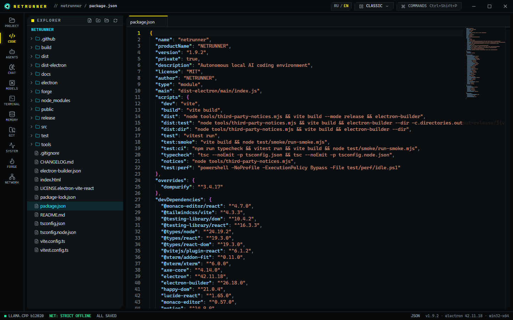
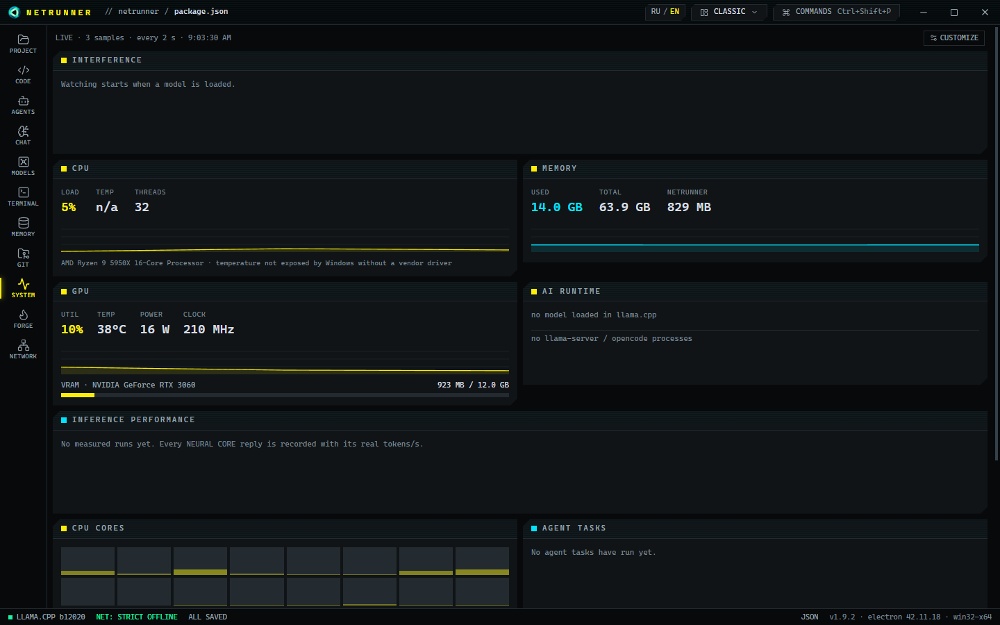

# NETRUNNER

**A local AI workstation for developers on Windows.**
Code editor, AI chat, a team of AI agents, terminal and resource monitors in one app. Every model runs on your own
computer: your code and conversations never leave it, and after installation no internet connection is needed.

[Русская версия](README.ru.md)



## Installation

1. Download **`NETRUNNER_Setup_<version>.exe`** from
   [Releases](https://github.com/StanislavTerekhov/NETRUNNER/releases/latest).
2. Run it. The installer is not code-signed, so Windows SmartScreen may say "Windows protected your PC" — click
   **More info → Run anyway**.
3. Click "Next" until it finishes. No administrator rights are needed.

That is all. The installer:

- installs NETRUNNER and the llama.cpp engine together with the Visual C++ runtime and ripgrep;
- downloads every model (about 85 GB) — Qwen models from Hugging Face, NETRUNNER's own models from this repository —
  and checks each file's SHA-256;
- installs Git for Windows if it is missing (the agents need it).

An internet connection is needed during installation: downloading the models takes from half an hour to several
hours depending on your connection. A slow or dropped connection is resumed automatically; if you close the
installer, the next run continues where it stopped and skips models that are already in place. The NVIDIA graphics
driver is installed separately from [nvidia.com](https://www.nvidia.com/drivers).

To uninstall: **Settings → Apps → NETRUNNER**. This removes the program, the engine and the models; your projects and
settings are left alone.

## System requirements

| | Minimum | Recommended |
|---|---|---|
| OS | Windows 10 (1809) x64 | Windows 11 x64 |
| CPU | x64, 4 cores | 8 cores or more (Ryzen 7/9, Core i7/i9) |
| RAM | 16 GB — chat works | **64 GB** — agents on Qwen3-Coder-Next |
| GPU | optional: without NVIDIA the models run on the CPU, slowly | NVIDIA with **12 GB** VRAM (RTX 3060 12 GB or better), driver R580+ |
| Disk | 100 GB free | 100 GB on an SSD |
| Internet | only during installation | — |

Speed on the recommended configuration (Ryzen 9 5950X, 64 GB, RTX 3060 12 GB):

| Model | Role | Generation | Load time |
|---|---|---|---|
| Qwen3.8-27B IQ3_XXS | chat, images | ~15 tokens/s | ~30 s |
| Qwen3-Coder-Next Q4_K_M (MoE, 512 experts) | agents | ~22 tokens/s | ~90 s from disk, ~8 s again |
| netrunner-v3 (Qwen3.5-4B fine-tuned in FORGE) | fast chat | ~80 tokens/s | ~9 s |

## Features

- **CODE** — Monaco editor with highlighting, completion and type checking (pyright), project files, git.
- **CHAT** — conversations with a local model: streamed answers, images, history search, answers grounded in the
  project's memory.
- **AGENTS** — Architect, Coder, Debugger and Reviewer on the OpenCode engine write and fix code in your project.
  Edits and commands run only after you approve them; you can review every change and roll back to a checkpoint.
  Up to four agents work in parallel, each in its own copy of the project (git worktree).
- **MODELS** — model catalog, load and unload, a placement plan across GPU and RAM, auto-tuning, fast mode and a
  VRAM saver.
- **MEMORY** — semantic search over the project's code: local embeddings and SQLite (sqlite-vec).
- **TERMINAL**, **SYSTEM** (CPU, RAM, GPU, VRAM, model speed), **NETWORK** (a log of every outgoing request,
  firewall rules), **FORGE** (fine-tune a model on your own project).
- English and Russian interface, workspace layouts, command palette (Ctrl+Shift+P).



## How it works

- **llama.cpp and GGUF.** Models are quantized to 3–4 bits, so a 27-billion-parameter model fits into 12 GB of VRAM.
  Qwen3-Coder-Next is a mixture of experts (MoE): for each token only 10 of its 512 experts work; they live in system
  RAM and the GPU computes the rest.
- **Reverse interference.** A model shares the computer with other programs. NETRUNNER measures who slows down whom
  and shows it. Measured: other programs using up to ~60 % of the CPU do not slow generation; at 81 % it drops by 39 %.
  Low free RAM, down to 1 GB, does not hurt. The real enemy is VRAM: when another program overfills it, Windows silently
  evicts the model and it runs twice as slow with no error at all. The monitor reports this and offers an action.
  Details (Russian): [docs/NSC-STAGE2.md](docs/NSC-STAGE2.md).
- **Memory elasticity.** The VRAM saver keeps MoE experts in RAM (4.8 GB of VRAM instead of 10.2 at −9 % speed); idle
  models are unloaded; a conversation is saved to disk before an unload and restored at the next load. Details
  (Russian): [docs/NSC-ME.md](docs/NSC-ME.md).
- **Auto-tuning.** The tuner keeps only launch settings that make a typical request at least 5 % faster and rolls a
  setting back on its own if speed later drops. The agents share one system prompt that the model does not re-read.
  Fast mode uses 8 experts instead of 10: +19 % speed with unchanged benchmark scores.
- **Security.** "Strict offline" is the default: network requests are blocked at four layers and logged. Agents work
  only inside the project and every edit or command waits for approval. Details: [docs/SECURITY.md](docs/SECURITY.md).

Architecture (Russian): [docs/ARCHITECTURE.md](docs/ARCHITECTURE.md). Fine-tuning (Russian):
[forge/README.md](forge/README.md). Changes: [CHANGELOG.md](CHANGELOG.md).

## FORGE (fine-tuning) — optional

Needs an NVIDIA GPU with 12 GB of VRAM and Python 3.13 ([python.org](https://www.python.org/downloads/windows/),
tick "Add python.exe to PATH"). In NETRUNNER switch **NETWORK** to "Online tools", press **SETUP** in **FORGE**
(downloads ~15 GB: PyTorch, Unsloth, the converter), then switch back to "Strict offline".

## Building from source

Requires Node.js 22+ and npm.

```bash
npm install
npx install-electron --no   # if npm did not run Electron's install script
npm run dev                 # development mode
npm run typecheck && npm test
npm run test:smoke          # real app window with automated UI checks
npm run dist                # NSIS installer without models: release/<version>/
```

The installer with models (as published in Releases) is built with Inno Setup 6:

```bash
node tools/installer/models-manifest.mjs                # SHA-256 of the models, checked against Hugging Face
node tools/installer/split-release-models.mjs <folder>  # FORGE models in parts under 2 GB for the release
node tools/installer/gen-models-iss.mjs
"%LOCALAPPDATA%\Programs\Inno Setup 6\ISCC.exe" /DAppVersion=<version> tools\installer\netrunner-setup.iss
```

## Licenses

NETRUNNER — [MIT](LICENSE). Qwen models — Apache-2.0. llama.cpp — MIT. Third-party components are listed in
`THIRD_PARTY_NOTICES.txt` in the installation folder and in
[tools/installer/LICENSES-RU.txt](tools/installer/LICENSES-RU.txt).
