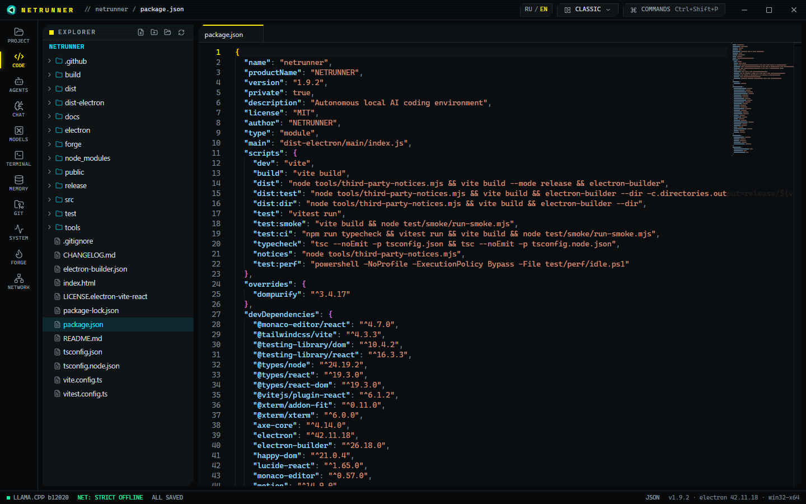
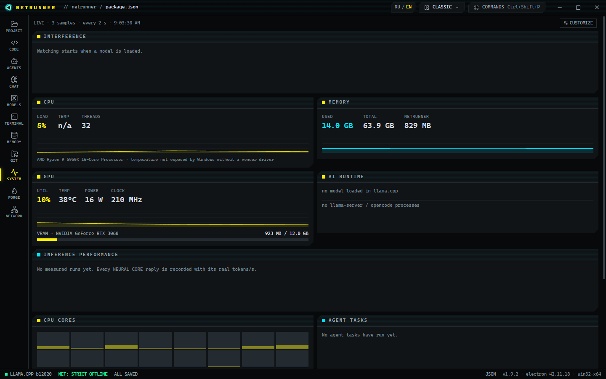

# NETRUNNER

**Локальная рабочая станция искусственного интеллекта для разработчика под Windows.**
Редактор кода, чат с нейросетью, команда ИИ-агентов, терминал и мониторы ресурсов в одном приложении. Все модели
работают на вашем компьютере: код и переписка никуда не отправляются, после установки интернет не нужен.

[English version](README.md)



## Установка

1. Скачайте **`NETRUNNER_Setup_<версия>.exe`** со страницы
   [Releases](https://github.com/StanislavTerekhov/NETRUNNER/releases/latest).
2. Запустите его. Установщик не подписан цифровой подписью, поэтому Windows SmartScreen может показать
   «Система Windows защитила ваш компьютер» → нажмите **«Подробнее» → «Выполнить в любом случае»**.
3. Нажимайте «Далее» до конца. Права администратора не нужны.

Больше ничего делать не нужно. Установщик сам:

- ставит программу NETRUNNER и движок llama.cpp с библиотеками Visual C++ и ripgrep;
- скачивает все модели (около 85 ГБ) — Qwen с Hugging Face, модели NETRUNNER из этого репозитория — и проверяет
  каждый файл по SHA-256;
- ставит Git for Windows, если его нет (он нужен агентам).

Во время установки нужен интернет: загрузка моделей занимает от получаса до нескольких часов в зависимости от скорости
подключения. Если связь прервётся, установщик повторит загрузку; при повторном запуске уже скачанное не качается
заново. Драйвер видеокарты NVIDIA ставится отдельно с [nvidia.com](https://www.nvidia.com/drivers).

Удаление — через «Параметры → Приложения → NETRUNNER»: удаляются программа, движок и модели. Ваши проекты и
настройки не трогаются.

## Системные требования

| | Минимальные | Рекомендуемые |
|---|---|---|
| ОС | Windows 10 (1809) x64 | Windows 11 x64 |
| Процессор | x64, 4 ядра | 8 ядер и больше (Ryzen 7/9, Core i7/i9) |
| Оперативная память | 16 ГБ — работает чат | **64 ГБ** — агенты на Qwen3-Coder-Next |
| Видеокарта | не обязательна: без NVIDIA модели работают на процессоре, медленно | NVIDIA с **12 ГБ** видеопамяти (RTX 3060 12 ГБ и выше), драйвер R580+ |
| Диск | 100 ГБ свободно | 100 ГБ на SSD |
| Интернет | только во время установки | — |

Скорость на рекомендуемой конфигурации (Ryzen 9 5950X, 64 ГБ, RTX 3060 12 ГБ):

| Модель | Роль | Генерация | Загрузка |
|---|---|---|---|
| Qwen3.8-27B IQ3_XXS | чат, изображения | ~15 ток/с | ~30 с |
| Qwen3-Coder-Next Q4_K_M (MoE, 512 экспертов) | агенты | ~22 ток/с | ~90 с с диска, ~8 с повторно |
| netrunner-v3 (Qwen3.5-4B, дообучена в FORGE) | быстрый чат | ~80 ток/с | ~9 с |

## Что умеет

- **КОД** — редактор Monaco: подсветка, подсказки и проверка типов (pyright), файлы проекта, git.
- **ЧАТ** — разговор с локальной моделью: потоковые ответы, изображения, поиск по истории, ответы по памяти проекта.
- **АГЕНТЫ** — Архитектор, Кодер, Отладчик и Ревьюер на движке OpenCode пишут и исправляют код в проекте. Правки
  и команды выполняются только после вашего подтверждения; есть просмотр изменений и откат к контрольной точке.
  До четырёх агентов параллельно, каждый в своей копии проекта (git worktree).
- **МОДЕЛИ** — каталог моделей, загрузка и выгрузка, план размещения по видеокарте и памяти, автонастройка,
  быстрый режим и экономия видеопамяти.
- **ПАМЯТЬ** — смысловой поиск по коду проекта: локальные эмбеддинги и база SQLite (sqlite-vec).
- **ТЕРМИНАЛ**, **СИСТЕМА** (CPU, RAM, GPU, VRAM, скорость моделей), **СЕТЬ** (журнал каждого исходящего
  запроса, правила брандмауэра), **FORGE** (дообучение модели на своём проекте).
- Интерфейс на русском и английском, раскладки рабочего места, палитра команд (Ctrl+Shift+P).



## Как это работает

- **llama.cpp и GGUF.** Модели сжаты (квантованы) до 3–4 бит, поэтому 27-миллиардная модель помещается в 12 ГБ
  видеопамяти. Qwen3-Coder-Next устроена как MoE («смесь экспертов»): на каждое слово работают 10 экспертов из 512,
  они лежат в оперативной памяти, видеокарта считает остальное.
- **Обратная интерференция.** Модель делит компьютер с другими программами. NETRUNNER измеряет, кто кому мешает, и
  показывает это. Замеры: чужая нагрузка на процессор до ~60 % на скорость не влияет, при 81 % генерация падает на
  39 %; нехватка оперативной памяти вплоть до 1 ГБ свободной не мешает. Главный враг — видеопамять: если другая
  программа её переполняет, Windows молча вытесняет модель, и она работает вдвое медленнее. Монитор сообщает об этом
  и предлагает действие. Подробно: [docs/NSC-STAGE2.md](docs/NSC-STAGE2.md).
- **Эластичность памяти.** Экономия VRAM держит экспертов MoE в оперативной памяти (4,8 ГБ видеопамяти вместо 10,2
  при −9 % скорости); простаивающие модели выгружаются; разговор сохраняется на диск перед выгрузкой и
  восстанавливается при следующей загрузке. Подробно: [docs/NSC-ME.md](docs/NSC-ME.md).
- **Автонастройка.** Автотюнер оставляет только параметры, которые ускоряют типичный запрос минимум на 5 %, и сам
  откатывает настройку, если скорость упала. Агенты используют общий системный промпт, который модель не
  перечитывает. Быстрый режим уменьшает число экспертов с 10 до 8: +19 % скорости при прежних оценках качества.
- **Безопасность.** По умолчанию режим «Полностью офлайн»: сетевые запросы блокируются на четырёх уровнях и
  записываются в журнал. Агенты работают только внутри проекта. Подробно: [docs/SECURITY.md](docs/SECURITY.md).

Архитектура: [docs/ARCHITECTURE.md](docs/ARCHITECTURE.md). Дообучение: [forge/README.md](forge/README.md).
Изменения: [CHANGELOG.md](CHANGELOG.md).

## FORGE (дообучение) — по желанию

Нужны NVIDIA с 12 ГБ видеопамяти и Python 3.13 ([python.org](https://www.python.org/downloads/windows/), отметьте
«Add python.exe to PATH»). В NETRUNNER включите в разделе **СЕТЬ** режим «Онлайн-инструменты», в разделе **FORGE**
нажмите **SETUP** (скачается ~15 ГБ: PyTorch, Unsloth, конвертер), затем верните «Полностью офлайн».

## Сборка из исходников

Нужны Node.js 22+ и npm.

```bash
npm install
npx install-electron --no   # если npm не запустил install-скрипт Electron
npm run dev                 # режим разработки
npm run typecheck && npm test
npm run test:smoke          # реальное окно приложения с автоматической проверкой интерфейса
npm run dist                # установщик NSIS без моделей: release/<версия>/
```

Установщик с моделями (как в Releases) собирается Inno Setup 6:

```bash
node tools/installer/models-manifest.mjs      # SHA-256 моделей, сверка с Hugging Face
node tools/installer/split-release-models.mjs <папка>   # модели FORGE частями < 2 ГБ для релиза
node tools/installer/gen-models-iss.mjs
"%LOCALAPPDATA%\Programs\Inno Setup 6\ISCC.exe" /DAppVersion=<версия> tools\installer\netrunner-setup.iss
```

## Лицензии

NETRUNNER — [MIT](LICENSE). Модели Qwen — Apache-2.0. llama.cpp — MIT. Сторонние компоненты перечислены в
`THIRD_PARTY_NOTICES.txt` в папке программы и в [tools/installer/LICENSES-RU.txt](tools/installer/LICENSES-RU.txt).
